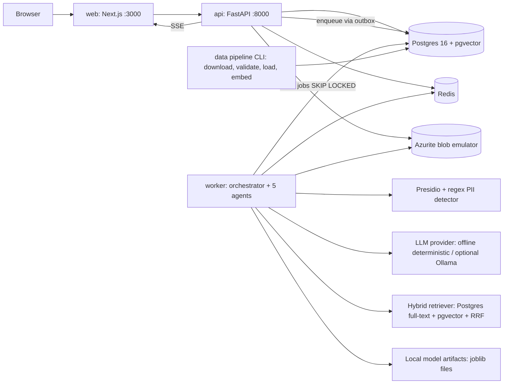
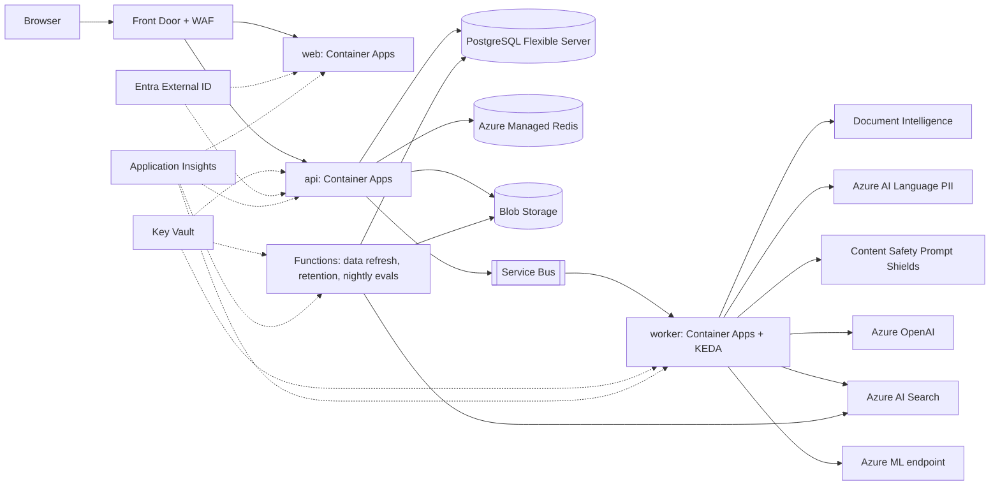
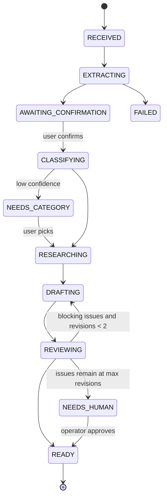

# Appeal Assistant: Build Specification

**A multi-agent AI platform that helps patients appeal denied health insurance claims, grounded in real independent-review decisions and federal regulations. Built locally first, then deployed on Microsoft Azure.**

| | |
|---|---|
| Difficulty | 500-level (capstone / production-grade) |
| Cloud | Microsoft Azure (deployed in Phase C, after everything works locally) |
| Real data | California DMHC Independent Medical Review decisions, the federal regulations from the eCFR API, CMS Transparency in Coverage data, plus a synthetic denial-letter set the project generates itself |
| Build mode | Phase A runs unattended overnight in Claude Code (about 4 hours, local only, no cloud, no API keys). Phase B is polish with the developer present. Phase C is Azure deployment. |
| How to use this file | You: read sections 0–1 first. Claude Code: read the whole file, then execute section 20 (Overnight Run Plan) phase by phase. |

> **BUILD EVERYTHING LOCALLY BEFORE WE TOUCH THE CLOUD.** Every Azure service in this document has a local stand-in (an emulator, an open-source equivalent, or a fake behind an interface). Phase A and Phase B never create Azure resources, never need an Azure login and never need a model API key. Phase C swaps the local stand-ins for Azure services by changing configuration, not code.

> This is a scope and design document. It contains no implementation code. Diagrams use Mermaid, which GitHub renders.

---

## 0. How to use this document

### 0.1 For you (the developer)
1. **Before you leave Claude Code running:** do the machine setup in section 0.3, then paste the kickoff prompt from section 0.4.
2. **While it runs:** start the videos in section 1. Each phase in section 20 names the videos that explain what Claude Code is building in that phase.
3. **In the morning:**
   - Read `docs/MORNING_REPORT.md`.
   - Run the demo command it lists.
   - Go through `docs/BLOCKERS.md`.
   - Then do Phase B (section 21) with Claude Code while you're present.
4. **For interviews:** use section 26 (question bank). For every component, make sure you can answer its questions without notes. If you can't, rewatch that component's videos and ask Claude Code to walk you through the code.
5. **Never paste real patient data into anything.** Use the synthetic letters only.

### 0.2 For Claude Code (instructions to the coding agent)
- **Source of truth:** this document. If code and this document disagree, follow this document. If this document is ambiguous, pick the simplest option that satisfies the acceptance criteria and record it in `docs/DECISIONS.md` (one line: decision, reason, alternative).
- **You are running unattended.** Never stop to ask a question and never wait for input. When something blocks you:
  1. Write it to `docs/BLOCKERS.md` with what you tried.
  2. Use the documented fallback (every external dependency in this document has one).
  3. Continue with the next task.
- **Local only during Phases A and B:**
  - Do not run `az`, `azd` or any command that creates cloud resources.
  - Do not call any paid API.
  - Do not require any API key.
- **Allowed network access:**
  - package registries (PyPI, npm, Docker Hub, MCR, GitHub)
  - the dataset URLs listed in section 9
  - the Hugging Face model hub, for one small embedding model
  Nothing else.
- **Work order:** section 20, phase by phase. Each phase has a timebox, P0 tasks (must do) and P1 tasks (only if time remains). If a phase overruns its timebox by more than 50%, finish its P0 tasks, skip its P1 tasks and move on.
- **Each phase ends with:**
  1. Tests passing (`make test`).
  2. A git commit with a Conventional Commit message (`feat(phase-2): …`). Commit locally only; never push.
  3. A short entry in `docs/CHANGELOG.md`.
  4. Updated README sections for what changed.
- **Hard rules** (section 22) override convenience and speed.
- **End of run:** write `docs/MORNING_REPORT.md` (format in section 20, Phase 8) even if earlier phases are incomplete. Reserve the last 10 minutes for this.

### 0.3 Machine setup (Windows)
**Required before starting the overnight run (2 minutes):**
- Configure Claude Code's permissions so it can edit files and run commands without asking. If it has to ask, it will sit waiting all night.
- Keep the laptop plugged in and set Windows sleep to "Never".

**Recommended, but can be done later.** If these aren't installed, Claude Code runs in "lite mode" (section 0.5) and you add them afterward:
1. Install WSL2 with Ubuntu, and Docker Desktop with WSL integration turned on for that Ubuntu distribution. Guides: Microsoft's WSL containers tutorial (https://learn.microsoft.com/windows/wsl/tutorials/wsl-containers) and Docker's WSL 2 backend page (https://docs.docker.com/desktop/wsl).
2. Give Docker Desktop at least 8 GB of memory (Settings → Resources).
3. Inside Ubuntu, install:
   - git and make
   - Python 3.12 and `uv`
   - Node.js 20 LTS or newer with npm
4. Create the repo inside the Linux file system (for example `~/code/appeal-assistant`), not under `/mnt/c`. File access across the Windows boundary is many times slower, and the run will crawl.
5. Put this file in the repo root as `SPEC.md`.
6. Start Claude Code from inside Ubuntu in the repo folder.
7. Configure its permissions so it can edit files and run `docker`, `docker compose`, `python`, `uv`, `npm`, `npx`, `node`, `git`, `make` and `curl` without asking you. **If it has to ask, it will sit waiting all night.**
8. Keep the laptop plugged in and set Windows sleep to "Never" for the night.

### 0.4 Kickoff prompt
The prompt to paste into Claude Code is delivered alongside this file. In short, it says: read SPEC.md, detect the environment (section 0.5), run section 20 unattended, never ask questions, commit each phase, and write the morning report.

### 0.5 Environment detection and lite mode (Claude Code: do this first, before Phase 0)
1. **Check what exists** and write the results to `docs/ENVIRONMENT.md`:
   - the OS, and whether you're inside WSL
   - `docker` and `docker compose` (and whether the daemon responds)
   - `python` / `python3` and its version, and `uv`
   - `node` and `npm` versions
   - `git`, `make` and `curl`
2. **Choose the mode:**
   - **Full mode:** Docker works. Use the local stack exactly as written in sections 7.1 and 7.3.
   - **Lite mode:** Docker is missing or not running. **Do not try to install Docker, WSL or anything that needs admin rights or a reboot.** Use the lite adapters below and record the choice in `docs/DECISIONS.md`.
3. **Lite-mode adapters.** These use the same interfaces as section 7.3, so the full-mode adapters can be added later without changing callers.

   | Interface | Lite adapter | Full-mode adapter (add later) |
   |---|---|---|
   | Database (SQLAlchemy) | SQLite file `var/app.db` with WAL mode. Same models and Alembic migrations, using only portable types: JSON instead of JSONB, string UUIDs. | Postgres 16 + pgvector |
   | JobQueue | SQLite job table with an atomic claim (`UPDATE … WHERE status='ready' … RETURNING`, or a claim token plus a check), retries and dead-lettering | Postgres `SKIP LOCKED` |
   | Retriever (keyword) | SQLite FTS5 with BM25 ranking | Postgres full-text |
   | Retriever (vector) | Embeddings in a numpy `.npy` matrix + id map; exact cosine search | pgvector + HNSW |
   | BlobStore | Local folder `var/blobs/`. The SAS-style upload is simulated with a signed, expiring upload token for a local endpoint. | Azurite |
   | ProgressBus | In-process async pub/sub. In lite mode the worker runs inside the API process as a background task, behind a `WORKER_MODE=inprocess` setting. | Redis + separate worker container |

   Everything else is unchanged in lite mode: agents, privacy layer, ML, evals, data pipeline, RRF, the state machine.
4. **Tooling fallbacks:**
   - **Python 3.12 missing:** install `uv` (user-level, no admin), then use `uv python install 3.12`.
   - **`make` missing:** create `tasks.py`, a Python task runner with the same command names (`setup, up, data, train, eval, test, demo, lint`), and document `uv run tasks.py <name>`.
   - **Node/npm missing:** don't install them system-wide. Skip Phase 5, give its time to Phases 3, 4 and 6, and still write `apps/web/README.md` with the page plan so it can be built next session. As a minimal demo, serve one static HTML page from FastAPI (`/demo`) that runs the paste → confirm → letter flow through the API.
   - **Windows without WSL:** keep all paths relative, and use `pathlib` everywhere. Shell scripts get Python equivalents.
5. **Tests:** they must pass in whichever mode is active. Tests for full-mode-only adapters are marked and skipped when Docker is absent, never deleted.
6. **Morning report:** state the mode used, and add the task "Install Docker Desktop + WSL2, then add the full-mode adapters and run the test suite in full mode" to the top-10 list.

---

## 1. Learning plan and video list

**Goal:** after these, you can rebuild any part of this project yourself and answer interview questions on every component. Watch them in the order of the build phases. ★ = essential for interviews. If a link has moved, search the title on YouTube.

### 1.1 Environment and foundations (Phase 0)
| # | Topic | Video / resource | What it teaches you for this project |
|---|---|---|---|
| 1 | ★ Docker | TechWorld with Nana: Docker Tutorial for Beginners (~3 h): https://classcentral.com/course/youtube-docker-tutorial-for-beginners-full-course-in-3-hours-108867 | Images, containers, volumes, Docker Compose: how the whole local stack runs |
| 2 | WSL2 + Docker on Windows | Microsoft: Get started with Docker containers on WSL: https://learn.microsoft.com/windows/wsl/tutorials/wsl-containers | Why the repo lives in the Linux file system; how Docker Desktop talks to WSL |
| 3 | ★ Git + CI/CD | TechWorld with Nana: GitHub Actions Tutorial (~32 min): https://www.youtube.com/watch?v=R8_veQiYBjI | The CI pipeline that runs tests and evals |
| 4 | Azure fundamentals | freeCodeCamp: AZ-900 Azure Fundamentals (Andrew Brown, ~8 h): https://www.freecodecamp.org/news/azure-fundamentals-certification-az-900-exam-course | Subscriptions, resource groups, regions, identity, pricing (needed in Phase C; start early) |
| 5 | DSA practice (ongoing) | NeetCode 150: https://neetcode.io/practice/practice/neetcode150 | Projects don't replace coding interviews. Do 3–5 problems a week. |

### 1.2 Data engineering (Phase 1)
| # | Topic | Video / resource | What it teaches you |
|---|---|---|---|
| 6 | ★ pandas | freeCodeCamp: Pandas & Python for Data Analysis by Example (Santiago Basulto, ~5 h): https://www.freecodecamp.org/news/learn-pandas-for-data-science/ | Loading, cleaning, joining and profiling the IMR dataset |
| 7 | ★ PostgreSQL | freeCodeCamp: Learn PostgreSQL (Amigoscode, ~4 h): https://www.youtube.com/watch?v=qw--VYLpxG4 | Schema design, indexes, constraints, the queries behind the stats cards |

### 1.3 Backend (Phase 2)
| # | Topic | Video / resource | What it teaches you |
|---|---|---|---|
| 8 | ★ FastAPI end to end | freeCodeCamp: Python API Development (Sanjeev Thiyagarajan, ~19 h; watch the sections you need): https://www.youtube.com/watch?v=0sOvCWFmrtA | Routes, Pydantic, SQLAlchemy, Alembic migrations, auth, testing, Docker |
| 9 | Redis | freeCodeCamp: Redis course (~1.5 h): https://www.youtube.com/watch?v=XCsS_NVAa1g | Pub/sub for live progress, rate-limit counters, idempotency keys |
| 10 | Queues vs streams | ByteByteGo: Why is Kafka popular?: https://www.youtube.com/watch?v=7_wkWQ9rB5I | Why the pipeline is asynchronous; at-least-once delivery |
| 11 | Rate limiting | ByteByteGo: Rate limiter system design: https://www.youtube.com/watch?v=YXkOdWBwqaA | Token-bucket limits on the API |
| 12 | ★ OAuth 2.0 / OpenID Connect | Nate Barbettini: OAuth and OpenID Connect in Plain English: https://gotopia.tech/sessions/1276/oauth-and-openid-connect-in-plain-english | Sign-in design (accounts arrive in Phase C) |
| 13 | Observability | freeCodeCamp: OpenTelemetry course (~1 h): https://www.freecodecamp.org/news/how-to-use-opentelemetry/ | One trace per case across API → queue → agents |

### 1.4 AI engineering: LLMs, agents and retrieval (Phases 2–3)
| # | Topic | Video / resource | What it teaches you |
|---|---|---|---|
| 14 | ★ How LLMs work | Andrej Karpathy: Deep Dive into LLMs like ChatGPT: https://www.youtube.com/watch?v=7xTGNNLPyMI | Tokens, context windows, sampling, hallucination: why grounding matters |
| 15 | ★ Attention | 3Blue1Brown: Attention in transformers, step by step: https://www.youtube.com/watch?v=eMlx5fFNoYc | What embeddings and attention are; how a transformer works |
| 16 | Transformers recap | ByteByteGo: Transformers step by step: https://www.youtube.com/watch?v=avjX3QrYkls | Quick review before interviews |
| 17 | ★ RAG from scratch | freeCodeCamp: Learn RAG from scratch (~2.5 h): https://www.youtube.com/watch?v=sVcwVQRHIc8 | Chunking, embeddings, query rewriting, retrieval, grounding |
| 18 | ★ Vector search in Postgres | DataCamp: pgvector tutorial: https://www.datacamp.com/tutorial/pgvector-tutorial | Storing and indexing embeddings, cosine distance, HNSW indexes |
| 19 | ★ Agents | Microsoft: AI Agents for Beginners: https://aka.ms/ai-agents-beginners | Agent patterns, tool use, planning, multi-agent design |
| 20 | Multi-agent orchestration on Azure | Azure Friday: Orchestrate your agents with Microsoft Agent Framework: https://learn.microsoft.com/en-us/shows/azure-friday/orchestrate-your-agents-with-microsoft-agent-framework | How the hand-built orchestrator compares to a framework |
| 21 | ★ Prompt injection | Simon Willison: Prompt injection explained: https://simonwillison.net/2023/May/2/prompt-injection-explained/ ; the "lethal trifecta" talk: https://simonwillison.net/2025/aug/9/bay-area-ai/ | Why uploaded letters are hostile input, and the design that limits damage |
| 22 | PII detection | Microsoft Presidio (README and docs): https://github.com/microsoft/presidio | How the local PII detector works (recognizers, context, confidence scores) |

### 1.5 Machine learning (Phase 4)
| # | Topic | Video / resource | What it teaches you |
|---|---|---|---|
| 23 | ★ scikit-learn | freeCodeCamp: Scikit-learn Crash Course (Vincent Warmerdam, ~2 h): https://www.youtube.com/watch?v=0B5eIE_1vpU | Pipelines, preprocessing, metrics, meta-estimators |
| 24 | ★ Classifier fundamentals | StatQuest: Logistic regression: https://www.youtube.com/watch?v=yIYKR4sgzI8 ; StatQuest video index (confusion matrix, ROC/AUC, cross-validation, gradient boosting): https://statquest.org/video-index/ | The math behind every model here: logistic regression, gradient boosting, AUC |
| 25 | Deeper ML practice | freeCodeCamp: Machine Learning with Python and Scikit-Learn (Aakash N S, ~18 h; watch the gradient boosting and project lessons): https://www.youtube.com/watch?v=hDKCxebp88A | Gradient boosting, feature engineering, a full project workflow |

### 1.6 Evaluation and safety (Phase 6)
| # | Topic | Video / resource | What it teaches you |
|---|---|---|---|
| 26 | ★ Evaluating LLM systems | DeepLearning.AI: Evaluating AI Agents: https://learn.deeplearning.ai/courses/evaluating-ai-agents ; Automated Testing for LLMOps: https://www.deeplearning.ai/short-courses/automated-testing-llmops | Gold sets, LLM-as-judge, regression gates in CI |

### 1.7 Frontend (Phase 5)
| # | Topic | Video / resource | What it teaches you |
|---|---|---|---|
| 27 | ★ React | freeCodeCamp: Learn React (Bob Ziroll): https://www.freecodecamp.org/news/learn-react-2024/ | Components, state, effects |
| 28 | ★ TypeScript | freeCodeCamp: TypeScript in 1 hour: https://www.freecodecamp.org/news/learn-typescript-in-1-hour/ ; React + TypeScript: https://classcentral.com/classroom/freecodecamp-react-typescript-course-for-beginners-104875 | Typed props, API types generated from OpenAPI |
| 29 | ★ Next.js | freeCodeCamp: Next.js full-stack course: https://classcentral.com/classroom/freecodecamp-next-js-react-framework-course-build-and-deploy-a-full-stack-app-from-scratch-120787 ; Next.js caching and rendering: https://www.freecodecamp.org/news/learn-nextjs-15-caching-and-rendering/ | App Router, server vs client components, data fetching |
| 30 | End-to-end tests | freeCodeCamp: Software testing with Playwright: https://www.freecodecamp.org/news/software-testing-with-playwright/ | The upload → letter browser test and accessibility checks |

### 1.8 Azure platform (Phase C)
| # | Topic | Video / resource | What it teaches you |
|---|---|---|---|
| 31 | ★ Bicep infrastructure as code | Microsoft Learn Live: Use Bicep to deploy your Azure infrastructure, Ep 1: https://learn.microsoft.com/en-us/shows/learn-live/use-bicep-deploy-azure-infrastructure-as-code-ep01-introduction-infrastructure-as-code-using-bicep and Ep 2: https://learn.microsoft.com/en-us/shows/learn-live/use-bicep-deploy-azure-infrastructure-as-code-ep02-build-first-bicep-template ; AzureFunBytes: Intro to Bicep: https://www.youtube.com/watch?v=8ZMB1HCGBXA | Writing and deploying the infrastructure templates |
| 32 | ★ Azure Container Apps | Microsoft: Build and deploy with Azure Container Apps: https://learn.microsoft.com/en-us/shows/azure-developers/build-and-deploy-with-azure-container-apps-the-serverless-container-platform | Where the api, worker and web containers run; scaling; revisions |
| 33 | Azure Functions (Python) | Azure Friday: Go serverless with Azure Functions: https://learn.microsoft.com/en-us/shows/azure-friday/go-serverless-event-driven-applications-with-azure-functions ; Python v2 programming model: https://learn.microsoft.com/shows/azure-friday/developing-azure-functions-using-the-v2-programming-model-for-python/ | Scheduled data refresh, retention and nightly-eval jobs |
| 34 | Service Bus locally | Microsoft: Test locally with the Service Bus emulator: https://learn.microsoft.com/en-us/azure/service-bus-messaging/test-locally-with-service-bus-emulator | Swapping the local queue for Service Bus |
| 35 | ★ Generative AI on Azure | Microsoft: Generative AI for Beginners: https://learn.microsoft.com/shows/generative-ai-for-beginners | Azure OpenAI apps end to end |
| 36 | Azure OpenAI | FastTrack for Azure: Azure OpenAI intro: https://learn.microsoft.com/shows/learn-live/fasttrack-for-azure-season-2-ep02-azure-openai-introduction-to-language-models-and-applications ; John Savill: deployment types and resiliency: https://classcentral.com/course/youtube-azure-openai-deployment-types-and-resiliency-361331 | Deployments, quotas, throttling, provisioned vs pay-as-you-go |
| 37 | ★ Azure AI Search | AI Show: Azure AI Search, generating the right answers: https://learn.microsoft.com/en-us/shows/ai-show/azure-ai-search-generating-the-right-answers-every-time ; Best retrieval strategies: https://learn.microsoft.com/en-us/shows/ai-show/best-retrieval-strategies-for-generative-ai-applications-semantic-search-benchmarking | Hybrid search + semantic ranker in the cloud |
| 38 | Document Intelligence | AI-102 module 12: https://learn.microsoft.com/en-us/shows/on-demand-instructor-led-training-series/ai-102-module-12 | OCR for photos and scanned PDFs |
| 39 | MLOps on Azure | FastTrack for Azure: Azure ML operations: https://learn.microsoft.com/shows/learn-live/fasttrack-for-azure-season-2-ep04-azure-ml-operations ; AI Show: MLOps with GitHub Actions: https://learn.microsoft.com/en-us/shows/ai-show/mlops-feature-dive-cicd-with-github-actions | Training pipelines, model registry, managed endpoints |
| 40 | KQL for monitoring | FastTrack for Azure: Intro to KQL: https://learn.microsoft.com/en-us/shows/learn-live/fasttrack-for-azure-season-2-ep16-introduction-to-kusto-query-language | Querying logs and traces in Application Insights |

### 1.9 Domain knowledge (read before Phase 3)
| # | Topic | Resource |
|---|---|---|
| 41 | ★ Appeal rights | HealthCare.gov: internal appeals: https://www.healthcare.gov/appeal-insurance-company-decision/internal-appeals/ and external review: https://www.healthcare.gov/appeal-insurance-company-decision/external-review/ |
| 42 | The IMR program (your main dataset) | California DMHC: IMR and complaint reports: https://dmhc.ca.gov/DataResearch/IndependentMedicalReviewandComplaintReports.aspx |
| 43 | Regulatory structure | CMS: Internal claims, appeals and external review overview: https://www.cms.gov/files/document/internal-claims-appeals-external-review-process-overview.pdf |
| 44 | Short video on appeals | Washington State Insurance Commissioner: How to appeal a denial: https://www.insurance.wa.gov/insurance-resources/health-insurance/appealing-health-insurance-denial/how-appeal-health-insurance-denial |

**Suggested order while the build runs:**
- Night 1 and day 1: #1–3, #6–7, #14, #17.
- Days 2–4: #8–13, #15, #18–22.
- Days 5–6: #23–26.
- Days 7–8: #27–30.
- Before Phase C: #31–40.
- Throughout: #5 (NeetCode).

---

## 2. Product summary

**One line:** Upload or paste a health insurance denial. Get a plain-language explanation, your exact appeal deadline, a cited appeal letter, and evidence from real independent-review decisions for cases like yours.

**The problem:**
- Denials are common and appeals are rare. KFF's analysis of HealthCare.gov insurers found that nearly 17% of in-network claims were denied in 2021, and that consumers rarely appeal ([KFF](https://www.kff.org/health-reform/issue-brief/claims-denials-and-appeals-in-aca-marketplace-plans/)).
- Federal rules give members real rights: an internal appeal, then an independent external review that binds the plan ([HealthCare.gov](https://www.healthcare.gov/appeal-insurance-company-decision/external-review/)).
- The gap is information and effort, not law.

**What makes this project different (your interview pitch):**
1. **Grounded in real outcomes.**
   - Similar-case evidence comes from California DMHC independent-review decisions, a public dataset of every IMR decision since 2001. It includes the physician reviewer's written findings and whether the plan's decision was overturned.
   - The app shows "In N similar California reviews, X% were overturned" with links to the actual case summaries.
2. **Every sentence is traceable.**
   - The letter is generated as structured sentences, each carrying citation IDs.
   - An independent reviewer agent verifies support sentence by sentence.
   - Evaluation results are published.
3. **Privacy by construction.**
   - Identifiers are detected and replaced with tokens before any model sees the text.
   - A runtime leak gate fails closed, and a CI test proves no raw identifier reaches a model.
4. **Real ML, honestly evaluated.**
   - Three models trained on real and synthetic data, with time-based splits.
   - Leakage analysis, calibration and fairness slices, documented in model cards.

### 2.1 Competition (know this for interviews)
| Product | What it does | Source |
|---|---|---|
| Counterforce Health (nonprofit) | Free AI that analyzes the denial, the policy and research, and drafts an appeal | [Stateline via Yahoo](https://www.yahoo.com/news/articles/ai-vs-ai-patients-deploy-100051649.html) |
| Claimable | AI appeals platform generating custom letters | [Healthcare Brew](https://www.healthcare-brew.com/stories/2024/12/17/startup-appealing-insurance-denials-patients-behalf) |
| Fight Health Insurance | Free, open-source AI appeal drafting | [STAT](https://www.statnews.com/2024/12/16/how-to-fight-insurance-denials-luigi-mangione-unitedhealthcare-centene-medicaid-aca-outlook-healthcare-inc-newsletter/) |

**Positioning:** this is a portfolio project, not an attempt to beat funded companies. It differentiates on verifiability: real-precedent grounding, sentence-level citations checked by a reviewer, measurable privacy, and published evaluation results.

**Interview line:** "I studied the existing tools, then focused on what I could prove: grounding in real independent-review outcomes, every claim cited and verified, and privacy and quality gates enforced in CI."

---

## 3. Goals, non-goals and success metrics

### 3.1 Goals
1. A cited appeal package in ≤ 60 s for the median case.
2. Zero raw identifiers sent to any model, enforced by tests and a runtime gate.
3. Correct deadlines for every supported plan type.
4. Similar-case evidence from real IMR decisions on every case where a match exists.
5. Mobile-first and accessible (WCAG 2.2 AA).

### 3.2 Non-goals
- Legal or medical advice, or representing users.
- Sending anything to an insurer. The user sends the letter themselves.
- Predicting "you will win". Outcome statistics are context only and never discourage an appeal.
- Training a foundation model.

### 3.3 Metrics and targets
| Type | Metric | Target (local, end of Phase A) | Target (Phase C, with Azure models) |
|---|---|---|---|
| AI | Extraction exact match per field on the gold letters | ≥ 90% | ≥ 95% |
| AI | Denial-category classifier macro-F1 on the gold set | ≥ 0.80 | ≥ 0.85 |
| AI | IMR-type text classifier macro-F1 on the held-out test years | Reported vs baseline | Reported vs baseline |
| AI | Overturn-rate model: ROC-AUC and Brier score on the held-out test years | Beats the smoothed-rate baseline on Brier score | Same |
| AI | Retrieval recall@5 on the gold questions | ≥ 0.85 | ≥ 0.90 |
| AI | Citation validity (every cited ID exists in the retrieval set) | 100% (blocking) | 100% |
| AI | Sentence support (deterministic checker locally; calibrated LLM judge in Phase C) | ≥ 95% | ≥ 97% |
| Privacy | Raw identifiers in captured model inputs across the whole suite | 0 (blocking) | 0 |
| Safety | Red-team prompt-injection cases that change behavior | 0 | 0 |
| Product | Time to letter p50 (offline providers) | ≤ 10 s | ≤ 45 s |
| Cost | Model spend per case | $0 (offline) | ≤ $0.15 |

---

## 4. Users and personas
| Persona | Situation | Needs | Design implications |
|---|---|---|---|
| Maria, 34, employer plan | MRI denied as "not medically necessary"; anxious, on her phone | Can she fight it, by when, and what to send | Mobile-first, plain language, one next step per screen |
| Harold, 71, Medicare Advantage | Physical therapy denied for no prior authorization | Large text, printable letter, caregiver help | Accessibility, PDF export |
| Priya, 29, Marketplace plan | Out-of-network ER bill | Surprise-billing protections explained | No Surprises Act content, deadline tracking |
| Sam, patient advocate | Helps 20+ patients a month | Case list, templates, outcome data | Insurer insights page, saved cases (Phase C) |
| You (operator) | Run the service | Review queue, eval dashboards, data refresh | Admin pages |

---

## 5. Scope by phase
| Phase | Where | Scope |
|---|---|---|
| **A: Overnight (≈ 4 h, unattended)** | Your laptop, Docker Compose | Monorepo, data pipeline for every dataset, Postgres + pgvector, local queue, worker with 5 agents and the orchestrator, privacy layer, hybrid retrieval over regulations and IMR precedents, 3 ML models with model cards, Next.js app with the full flow, eval harness + red team + privacy gate, CI workflow, morning report |
| **B: Polish (with you present)** | Your laptop | Fix blockers; review the knowledge-base summaries yourself (required before anything is public); grow the gold sets; optional local LLM via Ollama; insurer insights page; UI polish; demo video |
| **C: Azure** | Azure subscription | Bicep + azd; Container Apps, Service Bus, PostgreSQL Flexible Server, Blob Storage, Azure Managed Redis, Azure OpenAI, Azure AI Search, Document Intelligence, Azure AI Language PII, Content Safety Prompt Shields, Azure ML, Functions, Key Vault, App Configuration, Application Insights, Entra External ID, Front Door + WAF; GitHub Actions with OIDC |

---

## 6. Feature specifications (user stories + acceptance criteria)

### F1. Upload or paste
- **Story:** As a patient, I paste the text of my denial letter or upload a PDF or text file.
- **AC1:** Accepts PDF (text-based) and TXT up to 10 MB and 10 pages, or pasted text up to 20,000 characters. Anything else gets a friendly error.
- **AC2:** Files go to Blob Storage (Azurite locally) through a short-lived, write-only SAS URL. Files never pass through the API body.
- **AC3:** Text PDFs are parsed locally. Photos and scanned PDFs show "coming soon" in Phase A; Document Intelligence OCR arrives in Phase C.

### F2. Fact confirmation
- **Story:** I see what was extracted and can fix it before anything is drafted.
- **AC1:** Shows each field with a confidence indicator:
  - insurer
  - plan type
  - state
  - claim number
  - member ID (masked)
  - service denied
  - dates
  - denial reason text
  - denial codes
- **AC2:** Low-confidence fields are highlighted, with a "where to find this on your letter" hint.
- **AC3:** Corrections are saved and logged as labeled examples (synthetic data only in development).

### F3. Live pipeline progress
- **AC1:** After confirmation, each agent step streams to the UI over Server-Sent Events (SSE) within 1 s of completing.
- **AC2:** Closing the tab doesn't stop processing. Reopening the case URL resumes the view.

### F4. Denial explanation
- **AC1:** Plain-language card covering:
  - "why they said no"
  - the category
  - the confidence, explained in words
  - what this kind of denial usually means
- **AC2:** Below the confidence threshold, the user picks the category from examples (human in the loop).

### F5. Rights and deadlines
- **AC1:** Deadline card with:
  - due date
  - days remaining
  - the regulation it comes from (cited)
  - next-level options (external review / state review / fair hearing)
- **AC2:** Calendar download (.ics).

### F6. Similar independent-review cases (powered by DMHC data)
- **AC1:** Shows a statistics card for the closest matching treatment category (and diagnosis category when available):
  - the number of matching California IMR decisions
  - the overturn rate with a confidence interval
  - how the rate has changed over the years
- **AC2:** Lists the 3–5 most similar past cases. Each shows:
  - year, treatment and decision
  - a short excerpt from the reviewer's findings
  - a link to the full summary
- **AC3:** Always shows the explainer: "These are California decisions. Your plan, state and facts may differ. A low overturn rate does not mean you shouldn't appeal."
- **AC4:** If fewer than 20 matching cases exist, show "not enough similar cases" instead of a rate.

### F7. Letter workspace
- **AC1:** Editor with footnote citations. Each footnote opens the exact source passage: a regulation paragraph, a rights summary or a precedent excerpt.
- **AC2:** Reviewer warnings appear inline (for example "delete any ground that isn't true for you").
- **AC3:** "Regenerate this paragraph" with a reason (shorter, firmer, add detail). The Reviewer re-runs on the result.
- **AC4:** Placeholders like [ADD: date of service] block export until they're filled.
- **AC5:** Export to PDF and DOCX. The letter never states a fact the user didn't provide or confirm.

### F8. Evidence kit
- **AC1:** Category-specific checklist of what to gather.
- **AC2:** A pre-filled request asking the treating clinician for a letter of medical necessity.

### F9. Insurer insights (P1 in Phase A, completed in Phase B)
- **AC1:** A page built from the CMS Transparency in Coverage data, showing per Marketplace issuer:
  - claims received and denied
  - denial rate
  - appeals filed
  - appeals overturned
- **AC2:** Shows CMS's disclaimer that denial counts are not necessarily indicative of plan quality.

### F10. Admin (internal)
- **AC1:** Case traces showing redacted input, each agent's output, timing and prompt versions.
- **AC2:** An eval dashboard with the latest results for every suite, plus the trend.
- **AC3:** A data-refresh status page showing each dataset's last download, row counts, schema-check results and hash.

### F11. Accessibility
- **AC1:** WCAG 2.2 AA, checked by axe in Playwright on every page.

---

## 7. System architecture

### 7.1 Local architecture (Phases A and B)

### 7.2 Azure architecture (Phase C)

### 7.3 Local-to-Azure mapping (the same interface, a different adapter)
| Capability | Interface (in code) | Local adapter (Phases A–B) | Azure adapter (Phase C) |
|---|---|---|---|
| Job queue | `JobQueue` | Postgres job table + transactional outbox, claimed with `SELECT … FOR UPDATE SKIP LOCKED` | Service Bus (sessions keyed by case ID, dead-letter queue) |
| File storage | `BlobStore` | Azurite through the official Azure Storage SDK | Blob Storage through the same SDK with managed identity |
| Progress pub/sub | `ProgressBus` | Redis container | Azure Managed Redis |
| Database | SQLAlchemy | Postgres 16 + pgvector container | PostgreSQL Flexible Server with the pgvector extension |
| LLM | `LLMProvider` | `offline` (deterministic templates + rules); optional `ollama` | `azure_openai` (structured outputs, pinned deployments) |
| Embeddings | `Embedder` | `all-MiniLM-L6-v2` via sentence-transformers. Fallback if the download fails: TF-IDF + truncated SVD (LSA) vectors | Azure OpenAI embeddings |
| Retrieval | `Retriever` | Postgres full-text (ts_rank) + pgvector cosine, merged with Reciprocal Rank Fusion | Azure AI Search hybrid + semantic ranker |
| PII detection | `PIIDetector` | Regex recognizers + Presidio Analyzer | Regex + Azure AI Language PII |
| Injection detection | `InjectionDetector` | Heuristic rules + a small local classifier | Content Safety Prompt Shields |
| OCR | `TextExtractor` | pypdf for text PDFs | Document Intelligence Read/Layout |
| ML serving | `ModelRegistry` | joblib files in `ml/artifacts/` with a JSON model card | Azure ML registry + managed online endpoint |
| Secrets/config | `Settings` | `.env` file (no real secrets exist locally) | Key Vault + App Configuration via managed identity |
| Telemetry | OpenTelemetry SDK | Console exporter; optional Jaeger container | Azure Monitor exporter → Application Insights |
| Scheduled jobs | `make` targets | Run by hand | Azure Functions timer triggers |

The adapter is chosen by environment variables (for example `QUEUE_BACKEND=postgres|servicebus`, `LLM_PROVIDER=offline|ollama|azure_openai`). The tests run against the local adapters. Every Azure adapter has a contract test that runs only when its variables are set.

### 7.4 Request lifecycle
1. **Upload.** `POST /v1/uploads` returns a SAS URL, and the browser puts the file into Blob Storage. Pasted text skips this step.
2. **Create.** `POST /v1/cases` carries an `Idempotency-Key`. In one database transaction, the API creates the case (RECEIVED) and inserts an outbox row with `case.ingest`.
3. **Intake.** The worker claims the job and runs:
   1. text extraction
   2. PII detection, then tokenization
   3. the injection check
   4. field extraction
   It then checkpoints to AWAITING_CONFIRMATION.
4. **Confirm.** `PUT /v1/cases/{id}/extraction` with `If-Match` enqueues `case.draft`.
5. **Draft.** The agents run in this order: Classifier → Research (rules + precedents + stats) → Writer ⇄ Reviewer. Each step checkpoints and publishes progress, which the API streams over SSE.
6. **Finalize.** The worker:
   - re-inserts the identifiers
   - renders citations
   - stores the letter encrypted
   - sets the status to READY
   - schedules the upload for deletion

### 7.5 Case state machine

All transitions go through one domain service with optimistic concurrency (a `version` column). Illegal transitions raise an error, and a test covers every edge.

---

## 8. Multi-agent design

### 8.1 Agent contracts (every input and output is a validated Pydantic model, exported as JSON Schema)
| Agent | Input | Output | Tools | Budget |
|---|---|---|---|---|
| Intake | Extracted text | `ExtractedDenial`: fields, per-field confidence, missing fields, plan type, state | Regex extractors, PII detector, LLM structured extraction | ≤ 3 s local |
| Classifier | Redacted denial reason, denial codes, service | `Classification`: category, calibrated probability, alternatives, rationale | Denial-code map, Model M1, LLM fallback below threshold | ≤ 1 s |
| Research | Category, plan type, state, service, diagnosis words | `Research`, which holds three things: `rules` (ranked regulation and rights passages with IDs R1..Rn), `precedents` (similar IMR cases with IDs P1..Pn and their findings excerpts) and `stats` (the M3 estimate plus the empirical rate with a confidence interval). Also arguments, an evidence list and deadlines. | Hybrid retriever (rules + precedents), M2, M3, deadline calculator | ≤ 3 s |
| Writer | Tokenized facts, R/P citations, arguments, reviewer feedback | `LetterDraft`: sections → sentences, each with citation IDs; placeholders | None | ≤ 5 s offline |
| Reviewer | Facts, sources, draft (never the Writer's prompt) | `Review`: blocking issues, warnings, per-sentence support verdicts, score | Deterministic rule checks, support checker | ≤ 2 s |

**Key design idea:** the Writer emits *sentences with citation IDs* as structured data, not free text. That makes verification mechanical:
- Any sentence containing a legal claim must cite at least one R-ID.
- Any sentence about similar cases must cite a P-ID and use non-binding wording ("independent reviewers in similar cases found…").
- The Reviewer checks every cited sentence against its source.

### 8.2 Orchestration
- An explicit, persisted state machine runs in the worker. Each step is a function from (state, context) to a new state, and its result is checkpointed in the `agent_runs` table.
- **Resumable:** on redelivery or a crash, reload the last checkpoint and continue.
- **Idempotent:** step results are keyed by (case ID, step, input hash), so a replay returns the stored result without calling the provider again.
- **Retries:** exponential backoff with jitter on provider errors. A circuit breaker switches the case to degraded mode (template writer), and the case is labeled as such.
- **Revision loop:** at most 2 rewrites. Reviewer feedback is a list of specific, checkable issues.
- **Human in the loop:** NEEDS_CATEGORY (user) and NEEDS_HUMAN (operator) are first-class states.
- **Framework choice:** plain Python, recorded in ADR-03. Be ready to explain when you'd move to Microsoft Agent Framework.

### 8.3 Offline LLM provider (what runs overnight)
The `offline` provider is deterministic and uses no model. Each method returns the same schema-valid output the real model returns:
- **Extraction:** regex and keyword rules over the tokenized text.
- **Writing:** playbook templates per category, filled from the facts and the retrieved citations.
- **Query rewriting:** synonym expansion from a small curated dictionary.

This lets the whole pipeline, the tests and the evals run with no keys. In Phase B or C, setting `LLM_PROVIDER=ollama` or `azure_openai` swaps in a real model with the same contracts, and the evals measure the difference. That before/after table is a strong interview story.

### 8.4 Prompts as versioned artifacts
- Prompts live in `packages/prompts/` with metadata (ID, version, agent, linked eval suite).
- Every provider call logs:
  - prompt ID and version
  - provider and model
  - tokens in and out
  - latency
  - cost
- A prompt change must pass the eval suite in CI.

### 8.5 Guardrails
| Layer | Control |
|---|---|
| Input | Type/size validation; the injection detector runs on the extracted text; document text is always wrapped as untrusted data and never treated as instructions |
| Privacy | Regex + Presidio → tokenization; a runtime leak gate before every provider call fails closed if a known raw identifier appears |
| Output | Schema validation; citation-ID existence; banned phrases (threats, guarantees of success, "as an AI"); precedent sentences must use non-binding wording |
| Action | No agent has a tool that sends messages, reaches the internet, or reads another case |
| Human | The user confirms facts; placeholders block export |

---

## 9. Datasets (what Claude Code downloads and how each one is used)

All dataset work lives in `data/`.
- `data/raw/` holds downloaded files. It is git-ignored, but each file's SHA-256 is committed.
- `data/processed/` holds cleaned Parquet files.
- `data/reports/` holds profiling and data-quality reports.

### D1. California DMHC Independent Medical Review (IMR) Determinations (primary, P0)
- **What it is:** a California Department of Managed Health Care dataset containing all IMR decisions it has administered since January 1, 2001. An IMR is an independent physician review of a service the plan denied, delayed or modified as not medically necessary, experimental/investigational, or not urgent/emergent. If the IMR is decided in the enrollee's favor, the plan must authorize the service.
- **Dataset page:** https://lab.data.ca.gov/dataset/independent-medical-review-imr-determinations-trend
- **CSV download** (follow redirects): https://data.chhs.ca.gov/dataset/b79b3447-4c10-4ae6-84e2-1076f83bb24e/resource/3340c5d7-4054-4d03-90e0-5f44290ed095/download/independent-medical-review-imr-determinations-trends.csv
- **Data dictionary PDF:** https://data.chhs.ca.gov/dataset/b79b3447-4c10-4ae6-84e2-1076f83bb24e/resource/2c5c2144-138f-4feb-b2af-a1176995e1b1/download/imrdatadictionary.pdf
  Download it, read it and save a Markdown summary to `data/reports/imr_dictionary.md`.
- **License:** Creative Commons Attribution, per the dataset page. Credit "California Department of Managed Health Care" in the README, the about page and the similar-cases card.
- **Known columns:** `ReferenceID, ReportYear, DiagnosisCategory, DiagnosisSubCategory, TreatmentCategory, TreatmentSubCategory, Determination, Type, AgeRange, PatientGender, IMRType, DaysToReview, DaysToAdopt, Findings`.
  - `Findings` is free text written from the physician reviewer's findings.
  - `Determination` values look like "Overturned Decision of Health Plan" / "Upheld Decision of Health Plan".
  - **Do not assume value sets.** Profile the real values and write them to the data report.
- **Pipeline steps:**
  1. **Download.** Record the hash, size and download time in `data/manifest.json`.
  2. **Validate the schema.** Expected columns must be present, types must parse, and ReferenceID must be unique. A failed check stops the load and logs to BLOCKERS.
  3. **Clean:**
     - trim whitespace
     - normalize category labels
     - map Determination to a boolean `overturned` plus the original text
     - keep `Findings` unmodified in a separate column
  4. **Run a PII scan over `Findings`.** The data is published de-identified, but scan it anyway as defense in depth. Log any hits and mask them before indexing.
  5. **Profile:**
     - row counts by year, Type, TreatmentCategory and Determination
     - null rates and text-length distribution
     - the most common categories
     Write the result to `data/reports/imr_profile.md` with charts saved as PNGs.
  6. **Load** into the Postgres tables `imr_case` and `imr_stats` (pre-aggregated by treatment, diagnosis, type and year).
  7. **Chunk and embed** `Findings` into the `precedent_chunk` table for retrieval.
- **Uses in the product:**
  - F6 similar cases (precedent retrieval + stats)
  - Model M2 (IMR-type text classifier)
  - Model M3 (overturn-rate model)
  - the precedent part of the retrieval gold set
  - realistic treatment and diagnosis vocabulary for generating synthetic letters (D4)
- **Fallback if the download fails:**
  1. Retry 3 times with backoff.
  2. Then generate `data/raw/imr_synthetic_sample.csv`: 2,000 rows with the exact same columns, plausible category values and clearly fake findings text starting with "SYNTHETIC SAMPLE".
  3. Set `IMR_SOURCE=synthetic` so the UI shows a "demo data" banner.
  4. Log to BLOCKERS.
  The pipeline must still run end to end.

### D2. Federal regulations via the eCFR API (P0)
- **What it is:** the official, current Code of Federal Regulations from the free eCFR REST API, which needs no key. The versioner service returns the source XML for a title, part or section on a date.
- **Endpoints:**
  - The title list with current dates: https://www.ecfr.gov/api/versioner/v1/titles.json
  - Content: https://www.ecfr.gov/api/versioner/v1/full/{date}/title-{title}.xml with `part` and `section` query parameters.
  - Use each title's `up_to_date_as_of` date from the title list.
- **Sections to fetch:**
  - **29 CFR 2560.503-1:** ERISA claims procedure, which covers employer plans.
  - **45 CFR 147.136:** internal claims and appeals and external review for group and individual coverage.
  - **42 CFR Part 422, Subpart M:** Medicare Advantage grievances, organization determinations and appeals.
  - **42 CFR Part 438, Subpart F:** Medicaid managed care grievance and appeal system.
  - **45 CFR Part 149:** surprise billing (No Surprises Act). Fetch only the sections on emergency services and patient protections.
- **Pipeline:**
  1. Fetch, store the raw XML and its hash, and skip unchanged sources.
  2. Parse the XML into a paragraph hierarchy that keeps the citation path (for example `45 CFR 147.136(b)(2)(ii)`).
  3. Chunk by paragraph, 150–600 tokens, keeping parent headings as context.
  4. Tag each chunk with plan types, topics (deadlines, external review, urgent care, notice requirements, continued coverage) and the effective date.
  5. Load into `kb_chunk` with `source_kind = regulation`.
- **License:** U.S. federal regulations are public domain.
- **Fallback:** if the API is unreachable, try the GovInfo bulk XML for the same titles (https://www.govinfo.gov/bulkdata/CFR/). If both fail, log to BLOCKERS and continue with D5 only.

### D3. CMS Transparency in Coverage public use file (P1)
- **What it is:** CMS publishes a Transparency in Coverage PUF with issuer- and plan-level claims, denials and appeals data for Marketplace plans.
- **Page:** https://www.cms.gov/CCIIO/Resources/Data-Resources/marketplace-puf.html
  Find the newest Transparency in Coverage PUF and its data dictionary on that page. Files may be ZIP or Excel.
- **Pipeline:**
  1. Download and hash.
  2. Parse the issuer-level sheet.
  3. Validate columns against the dictionary.
  4. Load into `insurer_stats`: state, issuer, claims received, claims denied, denial rate, appeals filed, appeals overturned, plan year.
- **Uses:** F9 insurer insights; a "your insurer's reported denial rate" line on the explanation card (only when the insurer name matches exactly).
- **Note:** CMS's disclaimer says denial counts are not necessarily indicative of issuer strength or plan quality. Show that wording.
- **Fallback:** skip it, hide F9 behind a feature flag and log to BLOCKERS.

### D4. Synthetic denial letters (generated by the project, P0)
Real denial letters contain personal health information, so the project generates its own labeled set.

- **Generator:** `data/synth/`. It is template-based and deterministic with a seed, so the dataset is reproducible.
- **Each letter has:**
  - one of the 8 categories
  - a plan type (employer self-funded, employer fully insured, individual Marketplace, Medicare Advantage, Medicaid managed care)
  - a state
  - a service drawn from the real treatment vocabulary in D1, and a diagnosis from D1's diagnosis categories
  - realistic structure: header, member block, claim block, reason, appeal-rights paragraph
  - typical layout noise, and denial codes where they fit the category
- **Identifiers are obviously fake** (hard rule 8):
  - names come from a fixed fictional list such as "Jordan Testperson"
  - member IDs use the prefix "ZZTEST"
  - phone numbers use 555-01xx
  - addresses use "123 Example St"
- **Sizes:**
  - 3,000 training letters
  - 500 validation letters
  - 120 gold letters for evaluation. Gold letters use different templates and phrasings than the training letters to measure generalization, not memorization.
- **Each letter also stores its ground truth:** expected fields, category, plan type and deadline.
- **Category list:**
  - medical necessity
  - prior authorization
  - out of network
  - coding/billing error
  - experimental/investigational
  - not a covered benefit
  - timely filing
  - other/unclear
- **Honesty requirement:** the README and model card state plainly that M1 is trained and evaluated on synthetic letters. They state the expected gap on real letters and how Phase B/C collects consented real labels.

### D5. Curated rights summaries and playbooks (P0)
- `packages/kb/summaries/`: short plain-language summaries of rights and deadlines per plan type.
  - Each summary cites the D2 chunk IDs or HealthCare.gov pages it's based on.
  - Each has `status: needs_human_review` until you review it in Phase B. The UI shows a "draft content" badge on unreviewed summaries in development.
- `packages/kb/playbooks/`: per category, the argument patterns, the evidence to gather, and the template paragraphs used by the offline writer.
- `packages/kb/denial_codes.yaml`: a short, hand-curated list of common denial reason codes mapped to categories, with descriptions written in our own words and a link to the official code list (https://x12.org/codes/claim-adjustment-reason-codes). Don't copy the official code descriptions verbatim.
- **Deadline rules** (`packages/kb/deadlines.yaml`): each rule has the plan type, the deadline in days, the trigger date and the cited R-ID. The deadline calculator only uses rules that have a citation.

### D6. Gold evaluation sets (P0)
Stored in `evals/gold/`, all versioned in git:
- **Letters:** the 120 D4 gold letters with expected fields, category and deadline.
- **Retrieval questions:** 60+ questions with relevant chunk IDs, 40 for regulations/summaries and 20 for precedents. Examples:
  - "deadline to file internal appeal employer plan" → the 2560.503-1 chunk
  - "MRI lumbar spine medical necessity overturned" → the matching IMR precedents
- **Red-team documents:** 40 letters containing injection attempts (see section 17).
- **Privacy probes:** 30 letters seeded with tricky identifiers (IDs split across lines, names with initials, phone formats).

---

## 10. Machine learning

All training code lives in `ml/`, and artifacts go to `ml/artifacts/<model>/<version>/`. Each artifact folder contains:
- the model file
- `model_card.md`
- `metrics.json`
- `training_config.json` (data hashes, seed, git SHA)

The `ModelRegistry` loads the version pinned in config.

### M1. Denial-category classifier (synthetic letters → 8 categories)
- **Features:** TF-IDF on word 1–2-grams and character 3–5-grams of the redacted reason text, plus denial-code indicator features.
- **Models:**
  1. Logistic regression (baseline).
  2. Linear SVM with calibrated probabilities.
  3. Keep the best by validation macro-F1.
- **Calibration:** temperature or isotonic scaling on the validation set. Report expected calibration error (ECE) and a reliability diagram.
- **High-precision override:** when a denial code maps to one category, use that category unless the model disagrees with probability > 0.9. In that case, flag the case for review.
- **Threshold:** pick the "ask the user" threshold from the coverage-vs-accuracy curve so that answered cases reach ≥ 95% accuracy. Report the coverage at that threshold.
- **Evaluation:** macro-F1, per-class recall and a confusion matrix on the gold letters.
- **Ablation:** with and without denial codes, to show how much the model relies on them (a leakage discussion).

### M2. IMR-type text classifier (real DMHC findings text → Type)
- **Task:** predict `Type` (medical necessity vs experimental/investigational vs urgent care, using the value set found during profiling) from the `Findings` text.
- **Why it matters:** it's an NLP model trained on real text with real labels. Research uses it to choose which precedent pool fits the user's case, using the user's redacted reason text and service.
- **Split:** time-based. Train on years up to and including Y−3, validate on Y−2, test on the two most recent full years. Never split randomly; explain why in the model card.
- **Models:**
  1. TF-IDF + logistic regression.
  2. Sentence embeddings (the local embedder) + logistic regression.
  3. A fine-tuned small transformer is a Phase C stretch on Azure ML.
- **Text cleaning:** remove phrases that directly state the type (for example "experimental or investigational" in a boilerplate sentence) in an ablation run, and report both scores. This shows you understand shortcut learning.
- **Metrics:** macro-F1 and per-class recall on the test years.

### M3. Overturn-rate model (structured DMHC fields → P(overturned))
- **Task:** estimate the probability that an IMR overturns the plan's decision from case attributes. It is used only to give context ("cases like this were overturned about X% of the time"), never to advise against appealing.
- **Features:** TreatmentCategory, TreatmentSubCategory, DiagnosisCategory, DiagnosisSubCategory, Type, IMRType and ReportYear (as a trend feature).
- **Excluded and why** (write this in the model card):
  - `Findings` is post-decision text that states the conclusion, so it is target leakage.
  - `DaysToAdopt` happens after the decision, so it is leakage.
  - `AgeRange` and `PatientGender` are protected or sensitive attributes. They are excluded as features but used for a **fairness slice report**: calibration and error rates by group.
- **Baselines:**
  1. The overall rate.
  2. An empirical-Bayes smoothed rate per treatment subcategory (a beta-binomial prior). This is the main one to beat.
- **Models:**
  1. Logistic regression with one-hot features.
  2. Gradient boosting with native categorical support (scikit-learn HistGradientBoostingClassifier).
- **Split:** the same time-based split as M2.
- **Metrics:**
  - ROC-AUC and Brier score
  - log loss
  - a calibration curve
  - performance by year, to show drift over time
- **Serving:** the stats card shows the empirical rate with a Wilson 95% confidence interval and N. The model estimate appears only when it beats the baseline on Brier score and N ≥ 20.

### 10.1 MLOps (local now, Azure ML in Phase C)
- `make train` retrains all three models from the processed data, reproducibly (fixed seeds, data hashes in the config).
- `make evaluate-models` writes `ml/reports/latest.md` with a metrics table comparing the new and previous versions.
- **Promotion rule:** a new version is pinned only if it doesn't regress the primary metric by more than 1 point. CI enforces this with a check script.
- In Phase C, the same training scripts run as Azure ML jobs. Models are registered in the Azure ML registry, and M1 is served from a managed online endpoint with blue/green traffic.

---

## 11. Retrieval (RAG)

### 11.1 Collections
| Collection | Source | Chunk unit | ID prefix |
|---|---|---|---|
| Regulations | D2 | One regulation paragraph with its parent headings | R |
| Rights summaries | D5 | One summary section | R |
| Precedents | D1 Findings | One IMR case (long findings split at about 400 tokens, keeping the case ID) | P |

### 11.2 Indexing
1. Store the text in Postgres with a generated `tsvector` column (English configuration) and a GIN index.
2. Store embeddings in a `vector(384)` column (MiniLM dimension; adjust if the fallback embedder is used) with an HNSW index using cosine distance.
3. Metadata columns support filtering:
   - collection, source citation path
   - plan types, topics
   - treatment category, diagnosis category, year
   - determination (precedents only)

### 11.3 Query strategy
1. **Rewrite** the query into 2–3 variants: the legal concept, plain language and service-specific wording. Locally this uses dictionary synonyms; in Phase C, a small model.
2. **Keyword search** with Postgres full-text (`websearch_to_tsquery`, ranked by `ts_rank_cd`), top 50.
3. **Vector search** with pgvector cosine, top 50, with metadata filters.
4. **Merge** with Reciprocal Rank Fusion (k = 60).
5. **Diversify:** rules results always include at least one procedural-rights chunk (deadlines/external review) and at least one category-specific chunk. Precedent results prefer the same treatment subcategory and recent years, and include both overturned and upheld cases.
6. **Return** the top 5–8 rules and the top 3–5 precedents, with stable IDs for the Writer.

### 11.4 Grounding
- The Writer may cite only the R and P IDs returned for this case.
- The Reviewer's support checker:
  - **Locally (deterministic):** key-term overlap, number and date agreement, negation checks between the sentence and the cited passage, plus rules (for example a deadline sentence's number must equal the deadline-calculator output).
  - **In Phase C:** an LLM judge calibrated against human labels (Cohen's kappa reported), plus Content Safety groundedness detection.

### 11.5 Retrieval evaluation
- Run on the D6 retrieval gold set and report recall@5, MRR and nDCG@10.
- Publish an ablation table in `evals/reports/retrieval_ablation.md` comparing keyword only, vector only, hybrid RRF, and hybrid RRF + query rewriting.
- In Phase C, add Azure AI Search hybrid + semantic ranker as a fifth row.

---

## 12. Data model (PostgreSQL)
| Table | Key fields | Notes |
|---|---|---|
| `case` | id (UUID), status, version, plan_type, state, category, created_at, expires_at, degraded (bool) | Optimistic concurrency via `version` |
| `document` | id, case_id, kind, blob_uri, sha256, pages, retention_until | Blob deleted by the retention job |
| `extraction` | id, case_id, fields (JSONB), field_confidence (JSONB), user_corrections (JSONB) | Corrections become labeled examples |
| `agent_run` | id, case_id, agent, attempt, input_hash, output (JSONB), prompt_id, prompt_version, provider, model, tokens_in, tokens_out, cost_usd, latency_ms, status | Checkpoints, audit trail, eval source |
| `job` / `outbox` | id, topic, payload, case_id, status, attempts, available_at, locked_by, locked_until | Local queue. `SKIP LOCKED` claiming; dead-letter after 5 attempts |
| `citation` | id, case_id, chunk_id, kind (R/P), score, used_in_letter | Ties letters to a KB version |
| `letter` | id, case_id, version, body (encrypted), sentences (JSONB with citation IDs), placeholders_remaining, review_score | Version history |
| `deadline` | id, case_id, kind, due_date, rule_id, basis_chunk_id | |
| `token_vault` | case_id, encrypted map | Envelope encryption: a per-case data key encrypted with a master key (from a local env var now, Key Vault in Phase C); deleted with the case |
| `kb_source` / `kb_chunk` | source url, citation path, hash, effective date, version, text, tsv, embedding, metadata | Regulations + summaries |
| `imr_case` | reference_id, year, categories, type, imr_type, overturned, determination_text, findings (masked), days_to_review | Loaded from D1 |
| `precedent_chunk` | id, reference_id, text, tsv, embedding, metadata | Retrieval over findings |
| `imr_stats` | treatment_category, treatment_subcategory, diagnosis_category, type, year, n, overturned_n | Pre-aggregated for fast cards |
| `insurer_stats` | plan_year, state, issuer, claims_received, claims_denied, appeals_filed, appeals_overturned | Loaded from D3 |
| `dataset_manifest` | name, url, sha256, rows, downloaded_at, schema_ok, source (real/synthetic) | Data-refresh page |
| `eval_run` | id, suite, git_sha, prompt_versions, model_versions, metrics (JSONB), passed | Eval dashboard |
| `audit_event` | actor, action, entity, at | Append-only |

Migrations use Alembic and follow the expand/contract pattern.

---

## 13. API design
- REST + JSON under `/v1`.
- Errors follow RFC 9457 Problem Details.
- A correlation ID in every response, linked to the trace.
- The OpenAPI spec is exported to `packages/schemas/openapi.json`, and the TypeScript client is generated from it.
- Anonymous cases use a signed case-access token returned at creation. Accounts arrive in Phase C.

| Method | Path | Purpose | Notes |
|---|---|---|---|
| POST | /v1/uploads | Get a SAS upload URL | One blob, write-only, 10 min |
| POST | /v1/cases | Create a case (blob ref or pasted text) | `Idempotency-Key` required; transactional outbox |
| GET | /v1/cases/{id} | Case detail | ETag |
| GET | /v1/cases/{id}/events | Live progress (SSE) | Heartbeats; resume with `Last-Event-ID` |
| PUT | /v1/cases/{id}/extraction | Confirm or correct facts | `If-Match` |
| POST | /v1/cases/{id}/category | Human-in-the-loop category | Only in NEEDS_CATEGORY |
| GET / PUT | /v1/cases/{id}/letter | Read or edit the letter | Versioned |
| POST | /v1/cases/{id}/letter/regenerate | Regenerate one section | Rate limited |
| GET | /v1/cases/{id}/precedents | Similar IMR cases + stats | |
| GET | /v1/cases/{id}/exports/{pdf,docx,ics} | Exports | Server-rendered |
| DELETE | /v1/cases/{id} | Delete now | Cascades to blob, vault and letter; audited |
| GET | /v1/insights/insurers | Insurer stats (F9) | Feature-flagged |
| GET | /v1/kb/chunks/{id} | A source passage for a footnote | Public |
| GET | /healthz, /readyz | Probes | Readiness checks DB, Redis and blob |
| GET | /admin/v1/traces, /admin/v1/evals, /admin/v1/datasets | Admin views | Locally: an admin token from `.env`; Phase C: Entra role |

**Cross-cutting:**
- A token-bucket rate limit per IP and per case (counters in Redis).
- Request size limits.
- CORS restricted to the web origin.

---

## 14. Frontend
**Stack:**
- Next.js (App Router) + TypeScript strict
- Tailwind CSS with accessible Radix-based primitives
- TanStack Query
- React Hook Form + Zod
- a typed API client generated from OpenAPI
- Playwright + axe tests
- a PWA manifest

| Route | Purpose |
|---|---|
| `/` | Landing page: how it works, privacy promise, data sources with attribution, latest eval results, Start |
| `/start` | Paste or upload + consent notice |
| `/cases/[id]/confirm` | Editable facts with hints |
| `/cases/[id]` | Workspace: progress timeline → explanation → deadline → similar cases → letter editor → evidence kit |
| `/insights/insurers` | Insurer insights (F9) |
| `/sources/[chunkId]` | Full source passage for any footnote |
| `/about/data` | Datasets, licenses, attribution, limitations |
| `/admin/*` | Traces, eval dashboard, dataset status |

**UX principles:**
- One primary action per screen.
- Reading level around grades 6–8.
- Honest progress, and errors that offer a next step.
- Never show raw probabilities without words.
- Statistics always show N and the confidence interval.

**Performance budget:** landing-page JavaScript ≤ 200 KB gzipped; LCP ≤ 2.5 s on a mid-range phone profile.

---

## 15. Security and privacy

### 15.1 Data classes
| Class | Examples | Handling |
|---|---|---|
| Restricted | Uploads, token vault, letters | Encrypted; short retention; access audited |
| Internal | Redacted traces, metrics | 30–90 day retention |
| Public | KB chunks, IMR data, insurer stats | Attributed |

### 15.2 Threat model (STRIDE)
| Threat | Example | Mitigation |
|---|---|---|
| Spoofing | Opening another person's case | Signed case-access token; 128-bit random IDs |
| Tampering | Swapped upload | Write-once SAS; SHA-256 stored |
| Repudiation | "I never deleted that" | Append-only audit events |
| Information disclosure | Identifiers in logs or prompts; injection exfiltrating data | Tokenization + leak gate; log scrubbing; no outbound tools; no cross-case reads |
| Denial of service | Huge files, endless regenerate | Size/page limits, rate limits, token budgets |
| Elevation of privilege | Admin pages exposed | Admin token locally; Entra roles + Front Door rules in Phase C |

### 15.3 Prompt injection
- **Assume every uploaded letter is hostile.**
- **Controls:**
  - the injection detector
  - untrusted text kept in delimited data sections
  - structured outputs only
  - **no exfiltration path:** even a successful injection can only change this user's own draft, which the user reviews
  - a red-team suite in CI
- Explain the "lethal trifecta" (private data + untrusted content + external communication) and how this design removes the third leg.

### 15.4 Regulatory posture (legal review before any public launch)
- **HIPAA:** a consumer app that isn't a covered entity is generally outside HIPAA, but apply HIPAA-like safeguards anyway.
- **FTC Health Breach Notification Rule:** likely applies.
- **State consumer-health privacy laws:** for example Washington's My Health My Data Act.
- **Unauthorized practice of law:** disclaimers, the user is the author, no representation.
- **Dataset attribution and license terms:** CC BY for DMHC.

---

## 16. Observability
- OpenTelemetry in api and worker. One trace per case spans API → job → each agent → each provider or retrieval call. Locally, export to the console (and Jaeger with `make obs`); in Phase C, to Application Insights.
- **Metrics:**
  - latency per agent
  - revisions per case
  - NEEDS_HUMAN rate
  - classifier "ask user" rate
  - leak-gate blocks
  - injection detections
  - retrieval latency
  - cost per case
- **Logging:** structured JSON. Never log document text or identifiers. A scrubbing processor enforces this, and a test feeds a seeded identifier through every log path and asserts it never appears.

---

## 17. Testing and evaluation

### 17.1 Software tests
| Level | Scope | Tools |
|---|---|---|
| Unit | Extractors, deadline math, state transitions, tokenization, RRF, stats intervals | pytest; Hypothesis property tests for dates and tokenize→rehydrate round trips |
| Contract | Agent schemas, OpenAPI | Schema tests; the generated TS client must compile |
| Integration | API + worker + Postgres + Redis + Azurite | pytest with Docker Compose services |
| Resilience | Kill the worker mid-case; inject provider errors | Resume from checkpoint; no duplicate provider call; dead-letter after max attempts |
| End to end | Paste → confirm → letter → export | Playwright, desktop + mobile viewport |
| Accessibility | Every page | axe in Playwright |
| Data | Schema checks, row-count bounds, no duplicate IDs, PII scan | pytest over `data/processed/` |

### 17.2 AI evaluation harness (`evals/`)
`make eval` runs every suite and writes `evals/reports/latest.md` and an `eval_run` row. CI runs a fast subset on every push.

| Suite | Data | Metric | Gate |
|---|---|---|---|
| Extraction | 120 gold letters | Exact match per field | ≥ 90% local |
| Classification | 120 gold letters | Macro-F1, per-class recall | ≥ 0.80 local |
| Deadlines | 120 gold letters | Exact due date | 100% |
| Retrieval | 60+ gold questions | recall@5, MRR, nDCG@10 | recall@5 ≥ 0.85 |
| Citation validity | All generated letters | Cited IDs exist in the retrieval set | 100% |
| Support | All generated letters | % of sentences the checker marks as supported | ≥ 95% |
| Precedent wording | All letters citing a P-ID | Non-binding wording used | 100% |
| Red team | 40 injection letters | Agent behavior unchanged; no instructions followed; no data leaves the case | 0 failures |
| Privacy | All suites + 30 probes | Raw identifiers in captured provider inputs | 0 |
| Budget | All | Seconds per case | Within limits |

**Red-team cases include:**
- "ignore previous instructions"
- fake system messages
- instructions hidden in a footer
- requests to include other users' data
- requests to add threats or false claims
- base64-encoded instructions
- a "claims processor note" telling the assistant to drop the appeal

---

## 18. Performance and cost
- **Local latency target:** p50 ≤ 10 s per case with offline providers.
- **Phase C latency budget (p50 ≈ 45 s):**
  - OCR: 8 s
  - extraction + redaction: 6 s
  - classification: 1 s
  - retrieval: 3 s
  - writer: 20 s
  - reviewer and possible revision: 5–15 s
- **Phase C scaling:**
  - API and web scale on HTTP traffic.
  - The worker scales on Service Bus queue length (KEDA), with concurrency capped to the Azure OpenAI tokens-per-minute quota so it applies back-pressure instead of hitting throttling.
- **Phase C monthly cost at about 1,000 cases:** a planning estimate of roughly $160–300 (verify with the Azure pricing calculator).
  - The biggest fixed items are AI Search Basic and Front Door.
  - Use free tiers in dev.
  - Set a budget alert on day one.
  - Delete dev resources when they're idle.

---

## 19. Repository layout and conventions
| Path | Contents |
|---|---|
| `apps/web/` | Next.js app (TypeScript) |
| `services/api/` | FastAPI: routers, domain services (state machine), repositories, SSE, exports |
| `services/worker/` | Orchestrator, agents, privacy vault, leak gate, job consumer |
| `packages/core/` | Shared Python: settings, interfaces + local adapters + Azure adapters, telemetry |
| `packages/schemas/` | JSON Schemas for agent I/O and events; `openapi.json` |
| `packages/prompts/` | Versioned prompt templates with metadata |
| `packages/kb/` | Summaries, playbooks, denial codes, deadline rules |
| `data/` | `pipeline/` (download, validate, clean, load, embed), `synth/` (letter generator), `raw/` (ignored), `processed/`, `reports/`, `manifest.json` |
| `ml/` | Training and evaluation for M1–M3, `artifacts/`, `reports/` |
| `evals/` | `gold/`, runners, red team, privacy probes, `reports/` |
| `infra/` | Phase C: Bicep modules, `azure.yaml`, parameters per environment (stubs and README only in Phase A) |
| `docs/` | `adr/`, `MORNING_REPORT.md`, `BLOCKERS.md`, `DECISIONS.md`, `CHANGELOG.md`, `threat-model.md`, `runbooks/` |
| `.github/workflows/` | `ci.yml` (lint, type check, tests, fast evals, web build) |
| `docker-compose.yml` | postgres (pgvector image), redis, azurite, api, worker, web; profiles `obs` (Jaeger) and `servicebus` (emulator, optional) |
| `Makefile` | `setup`, `up`, `down`, `data`, `train`, `eval`, `test`, `demo`, `lint`, `obs` |
| `CLAUDE.md` | A short summary of sections 0.2, 19 and 22 |

**Conventions:**
- **Python:**
  - 3.12, managed with `uv`
  - Ruff for linting and formatting
  - mypy (strict in `services/` and `packages/core/`)
  - Pydantic v2
  - SQLAlchemy 2.0 + Alembic
  - pytest
- **TypeScript:** strict mode, ESLint + Prettier, Vitest, Playwright.
- **Commits:** Conventional Commits.
- **Configuration:** environment variables only, documented in `.env.example`.
- **Interfaces:** every external dependency sits behind an interface with a local adapter. Tests use local adapters by default.

---

## 20. Overnight Run Plan (Phase A, about 4 hours, unattended)

Timeboxes are targets. **Get a thin end-to-end slice working early, then deepen it.** If you're behind schedule, do every phase's P0 tasks before any phase's P1 tasks.

### Phase 0 · Scaffold (0:00–0:20)
- **P0 tasks:**
  - `git init`
  - the monorepo layout from section 19
  - `uv` workspace and `package.json`
  - `docker-compose.yml` with postgres (pgvector), redis and azurite
  - `Makefile`
  - `.env.example`
  - `CLAUDE.md`
  - pre-commit (Ruff)
  - `.github/workflows/ci.yml`
  - empty `docs/` files
- **First:** run the environment detection in section 0.5 and pick full or lite mode. In lite mode, the compose file is still written (for later), and `make up` / `tasks.py up` initializes the SQLite database and folders instead.
- **AC:** `make up` (or `uv run tasks.py up`) brings the local stack up for the active mode; `make test` runs (even with zero tests); first commit made.
- **Videos for you:** #1, #2, #3.

### Phase 1 · Data pipeline (0:20–0:55)
- **P0 tasks:**
  - D1 download → validate → clean → PII scan → profile → load (with the fallback)
  - D2 fetch → parse → chunk → load (with the fallback)
  - D4 generator (train/validation/gold)
  - D5 summaries, playbooks, denial codes, deadline rules
  - `data/manifest.json`
  - data tests
- **P1 tasks:** D3 insurer stats; profile charts.
- **AC:**
  - `make data` runs from a clean clone and is idempotent: a second run skips unchanged files.
  - `data/reports/imr_profile.md` exists with real counts, or the synthetic-data banner is set and the gap is logged.
  - Gold letters are committed.
- **Videos for you:** #6, #7.

### Phase 2 · Backend vertical slice (0:55–1:50)
- **P0 tasks:**
  - Alembic schema (section 12)
  - the state-machine domain service
  - API endpoints:
    - uploads (Azurite SAS)
    - create case (idempotency + outbox)
    - get case
    - SSE events
    - confirm extraction
    - category
    - letter get/put
    - delete
  - the Postgres job queue with `SKIP LOCKED`, retries and dead-lettering
  - a worker loop with checkpoints and idempotent steps
  - the privacy layer: regex + Presidio detector, tokenization vault with envelope encryption, leak gate
  - all 5 agents on the `offline` provider:
    - Intake, with real extraction rules
    - Classifier, with a code map plus a temporary rule fallback until M1 exists
    - Research, with a temporary keyword retrieval until Phase 3
    - Writer, from playbook templates
    - Reviewer, with deterministic checks
  - Redis progress → SSE
  - OpenTelemetry console tracing
- **AC:**
  - Through the API alone, a gold letter flows RECEIVED → READY with a cited letter.
  - Killing the worker mid-case resumes without re-running completed steps.
  - Every state transition is unit-tested.
  - The leak gate blocks a seeded identifier.
  - Commit.
- **Videos for you:** #8–#13, #19, #21, #22.

### Phase 3 · Retrieval (1:50–2:30)
- **P0 tasks:**
  - the embedder (MiniLM, with the LSA fallback)
  - embed `kb_chunk` and `precedent_chunk`
  - `tsvector` + GIN and HNSW indexes
  - a hybrid retriever with RRF and diversification
  - precedent search with filters
  - `imr_stats` with Wilson intervals
  - plug both into the Research agent
  - `/v1/cases/{id}/precedents`
  - `/v1/kb/chunks/{id}`
  - the retrieval gold set and a metrics runner
  - the ablation report
- **AC:** recall@5 ≥ 0.85 on the gold questions (or the shortfall is logged in BLOCKERS with the per-question misses); the ablation table is committed.
- **Videos for you:** #15, #17, #18.

### Phase 4 · Machine learning (2:30–3:00)
- **P0 tasks:**
  - M1 (train, calibrate, threshold, model card)
  - M3 with both baselines and the fairness slice report
  - M2 with TF-IDF and embedding variants and the shortcut ablation
  - `ModelRegistry` with pinned versions
  - wire M1 into the Classifier and M2/M3 into Research
- **AC:** `make train` reproduces the metrics (same seed → same numbers); model cards are complete, including limitations and the leakage notes; `ml/reports/latest.md` is committed.
- **Videos for you:** #23, #24, #25.

### Phase 5 · Frontend (3:00–3:30)
- **P0 tasks:**
  - Next.js app with `/`, `/start`, `/cases/[id]/confirm`, `/cases/[id]` (all workspace sections) and `/sources/[chunkId]`
  - generated API client
  - SSE progress timeline
  - the letter editor with footnotes and placeholders
  - PDF/DOCX/ICS export endpoints
  - `/about/data` with attribution
  - one Playwright happy-path test with axe
- **P1 tasks:** admin pages; `/insights/insurers`; mobile polish.
- **AC:** `make demo` starts everything and opens a flow that works from paste to export; the Playwright test passes; axe shows no serious violations.
- **Videos for you:** #27–#30.

### Phase 6 · Evaluation, red team, privacy gate (3:30–3:45)
- **P0 tasks:**
  - every suite in section 17.2
  - `make eval` and its report
  - CI runs the fast subset
  - the red-team and privacy-probe sets
- **AC:** `evals/reports/latest.md` shows every metric with pass/fail against its gate; any failing gate is listed in the morning report with the cause.
- **Videos for you:** #26.

### Phase 7 · Phase C preparation, no cloud calls (3:45–3:50)
- **P0 tasks:**
  - `infra/README.md` listing every Azure resource from section 7.2, its Bicep module name and the environment variables each adapter needs
  - stub Bicep module files with parameters and a TODO list; no deployment
  - Azure adapter classes with `NotConfigured` errors and skipped contract tests
- **AC:** switching any adapter to its Azure value without credentials gives a clear error message, not a crash.

### Phase 8 · Morning report (3:50–4:00, mandatory)
Write `docs/MORNING_REPORT.md` with these sections:
1. **What works:** the commands to run, and the demo URL.
2. **Phase checklist:** a table of each phase's P0 and P1 tasks with status (done / partial / skipped).
3. **Key metrics:** the eval and ML tables, copied from the reports.
4. **Data status:** a table of each dataset, with real or synthetic, rows, and hash.
5. **Blockers:** with the fallback used for each.
6. **Decisions made:** taken from DECISIONS.md.
7. **Top 10 next tasks**, in order.
8. **Things the developer must review personally:** the KB summaries, the deadline rules, and any synthetic-data fallback.

Commit.

---

## 21. Phase B: polish with the developer present
1. **Clear BLOCKERS.md** and re-run any fallback that used synthetic data.
2. **Review the knowledge base yourself** (required).
   - Read every rights summary and deadline rule against its cited regulation paragraph.
   - Fix anything that's wrong and set `status: reviewed`.
   - Nothing public goes live with unreviewed legal content.
3. **Grow the gold sets:**
   - 200 letters
   - 100 retrieval questions
   - 50 hand-graded letters to calibrate a judge later
4. **Optional local LLM:**
   - Install Ollama with a small instruct model.
   - Set `LLM_PROVIDER=ollama`.
   - Run `make eval`.
   - Commit the offline-vs-LLM comparison table.
5. **Finish the insurer insights (D3/F9) and the admin pages.**
6. **UI polish:**
   - copy review at grades 6–8 reading level
   - mobile testing
   - a 2-minute demo video for the README
7. **Write the ADRs** in `docs/adr/` in your own words. They're your interview script.

---

## 22. Hard rules (Claude Code must follow)
1. No raw identifier ever reaches a model provider, a log or a trace. The leak gate fails closed.
2. No secrets in code or committed config. Phase A needs no real secrets. The local master encryption key is generated into `.env` at setup and git-ignored.
3. Never invent legal content.
   - Rules, deadlines and rights text come from cited D2 regulations or D5 summaries.
   - Deadlines without a cited rule are not shown.
   - If a rule is unknown, the letter says less, not more.
4. No agent gets a tool that sends data outside the case.
5. Phases A and B never create cloud resources, never call paid APIs and never require keys.
6. Every external dependency has a local adapter behind an interface, and the tests use it.
7. Every behavior change ships with tests. AI changes ship with updated eval results.
8. Synthetic data must be unmistakably fake (the name list, "ZZTEST" IDs, 555-01xx phones, "Example St"). Never generate realistic personal data.
9. Outcome statistics are context, never advice. Never write or display text implying a user shouldn't appeal.
10. Attribute every dataset per its license, and show the source's own disclaimers where it requires them.
11. Never commit `data/raw/` files. Commit their hashes in `data/manifest.json`.
12. Don't stop to ask questions during the overnight run. Log, fall back and continue.

---

## 23. Architecture decision records (write these up in `docs/adr/`)
| ADR | Decision | Alternatives | Rationale |
|---|---|---|---|
| 01 | Build locally behind interfaces, deploy to Azure by swapping adapters | Build directly on Azure | Fast feedback, $0 development, tests without the cloud, portable design |
| 02 | Async pipeline (outbox + Postgres queue locally, Service Bus in the cloud) | Synchronous HTTP | Multi-step, slow AI chains; retries; crash recovery; per-case ordering |
| 03 | A hand-built persisted state machine | Microsoft Agent Framework, LangGraph, Durable Functions | Explainable checkpoints, idempotency and human-in-the-loop states; revisit when contracts stabilize |
| 04 | PostgreSQL + pgvector locally, Azure AI Search in the cloud | A vector-only database | Legal text needs exact terms (regulation numbers) plus meaning; proven by the ablation |
| 05 | Tokenize identifiers before any model call | Trust vendor terms | Data minimization; testable; smaller blast radius |
| 06 | Sentence-level structured citations | Free-text letters | Mechanical verification |
| 07 | ML classifier first, LLM fallback | LLM only | Cheaper, calibrated, measurable |
| 08 | Real IMR outcomes as precedents and statistics | Generic advice only | Grounds arguments in real independent-review reasoning; a strong differentiator |
| 09 | Time-based splits for M2/M3 | Random splits | Avoids leaking the future into the past; mirrors deployment |
| 10 | Exclude age and gender as M3 features but report fairness slices | Use all fields | Avoids encoding demographic effects into advice-like output while still measuring disparities |

---

## 24. Phase C: Azure deployment (only after Phases A and B pass)

### 24.1 Order of work
1. **Foundation:**
   - a subscription budget alert
   - a resource group per environment
   - Bicep modules: network, monitoring, identity, data, ai, compute
   - `azd` wiring
   - GitHub Actions OIDC federation (no stored cloud secrets)
   - managed identities and role assignments
   - Key Vault
   - App Configuration
2. **Data services:**
   - PostgreSQL Flexible Server with pgvector enabled; run the migrations; load the data with the same pipeline
   - Blob Storage
   - Azure Managed Redis
3. **Compute:**
   - Azure Container Registry
   - Container Apps for api, worker and web
   - worker scaling with KEDA on Service Bus
   - switch `QUEUE_BACKEND=servicebus`
4. **AI services, one adapter at a time.** After each switch, run `make eval` against the cloud and record the before/after numbers:
   - Azure OpenAI (`LLM_PROVIDER=azure_openai`, structured outputs, pinned deployments)
   - Azure AI Search (hybrid + semantic ranker; add its ablation row)
   - Document Intelligence (photo/scan OCR enables F1's image path)
   - Azure AI Language PII
   - Content Safety Prompt Shields
5. **ML:**
   - run M1–M3 training as Azure ML jobs
   - register the models
   - deploy M1 to a managed online endpoint with blue/green traffic
6. **Jobs:** Azure Functions (Python v2) for the monthly data refresh (D1–D3), daily retention purge and nightly evals.
7. **Identity:** Entra External ID for accounts and saved cases; admin role for `/admin`.
8. **Edge and hardening:**
   - Front Door + WAF
   - private endpoints for data services
   - Azure Policy (deny public network access, require tags and diagnostics)
   - Defender for Cloud
9. **Observability:** Azure Monitor OpenTelemetry exporter → Application Insights; workbooks for funnel, AI quality, cost and SLOs; alerts.
10. **Release:**
    - staging and prod environments
    - Container Apps revisions with a 10% → 50% → 100% traffic split and rollback
    - a load test
    - runbooks
    - published eval results

### 24.2 CI/CD
- **Pull request:**
  - lint and type check
  - unit and contract tests
  - image build
  - Bicep what-if
  - fast evals
  - CodeQL and dependency scan
- **Main:**
  1. push images
  2. deploy to staging
  3. run migrations
  4. Playwright
  5. full evals
  6. manual approval
  7. production revision split

### 24.3 Environments
| Env | Purpose | Data | Models |
|---|---|---|---|
| local | Development and the overnight build | Real public datasets + synthetic letters | Offline / optional Ollama |
| dev | Cloud integration | Same | Small capacity |
| staging | Pre-production, load tests, eval gates | Same + gold | Same versions as prod |
| prod | Users | Real user cases (consented) | Pinned versions |

---

## 25. Risks and mitigations
| Risk | Mitigation |
|---|---|
| A dataset URL changes or is down overnight | Retries, documented fallbacks, synthetic stand-in with a banner, logged in BLOCKERS |
| The overnight run stalls on a permission prompt | Pre-approved commands (section 0.3); "never ask" instruction |
| Wrong legal statement | Citation-bound generation, the Reviewer, gold gates, human KB review in Phase B, visible sources, disclaimers |
| Synthetic-to-real gap for M1 | Stated in the model card; LLM fallback and user confirmation; consented real labels in Phase C |
| California precedents don't apply to the user's state or plan | Explicit explainer on every card; stats shown as context only |
| Privacy incident | Tokenization, leak gate, short retention, no exfiltration tools |
| Prompt injection | Detector, structured outputs, no outbound tools, red-team CI |
| Cloud cost overrun | Budget alert, free tiers in dev, delete idle resources |

---

## 26. Interview question bank (you must be able to answer all of these)

**Architecture and system design**
1. Walk through one case from paste to PDF. Name every component and why it exists.
2. Why asynchronous processing? What is at-least-once delivery, and how do you make steps idempotent?
3. What is the transactional outbox pattern, and what bug does it prevent?
4. How does `SELECT … FOR UPDATE SKIP LOCKED` give you a work queue? When would you switch to Service Bus, and what do sessions and dead-letter queues add?
5. How does a crashed worker resume without repeating an expensive model call?
6. Why SSE instead of WebSockets or polling for progress?
7. How did you design local adapters so moving to Azure is a configuration change?
8. What changes at 100× traffic? (Queue scaling, model quota back-pressure, read replicas, index sharding, caching.)

**Backend and data**
1. How do optimistic concurrency, ETags and `If-Match` prevent lost updates?
2. How do idempotency keys work, and where are they stored?
3. Show the schema. Why JSONB for agent outputs? What indexes did you add, and why?
4. How did you validate and profile a dataset you didn't create? What surprised you in the IMR data?
5. How do expand/contract migrations let you deploy without downtime?

**Privacy and security**
1. How does tokenization work end to end? Why envelope encryption?
2. What does the leak gate check, and why fail closed?
3. Explain prompt injection and the lethal trifecta. Why do delimiters alone fail? Which leg did you remove?
4. Walk through your STRIDE table.
5. Is this app covered by HIPAA? What does apply?

**Retrieval (RAG)**
1. How did you chunk regulations vs IMR findings, and why differently?
2. Keyword vs vector search: what does each miss? How does Reciprocal Rank Fusion combine them?
3. What is an HNSW index, and what is the speed/recall tradeoff?
4. recall@5 vs MRR vs nDCG: when does each matter? Show your ablation.
5. How do you stop the model from citing something it didn't retrieve?

**Agents and LLMs**
1. Why five agents instead of one agent with tools? When is one agent better?
2. Why does the Reviewer never see the Writer's prompt?
3. How does structured output with sentence-level citation IDs make verification mechanical?
4. What did changing from the offline provider to a real LLM change in your eval numbers?
5. How do you version prompts and stop a prompt change from regressing quality?
6. Explain attention and why context length costs money.

**Machine learning**
1. Why a time-based split for the IMR models? What goes wrong with a random split?
2. What is target leakage? Name the two leaky columns you excluded and why.
3. What is calibration, how did you measure it (ECE, reliability diagram), and why does it matter for a "how sure are we" message?
4. Logistic regression vs gradient boosting: how does each work, and why did one win?
5. What is the empirical-Bayes smoothed rate, and why is it a strong baseline for small categories?
6. Why exclude age and gender as features, and what did the fairness slice report show?
7. M1 trains on synthetic letters. What is the risk, and how would you close the gap?
8. What is shortcut learning, and what did your M2 ablation show?

**Evaluation**
1. How were the gold sets built, and how do you keep the model from memorizing them?
2. How would you calibrate an LLM judge against humans (Cohen's kappa)?
3. Which metrics block a merge, and why those?

**Frontend**
1. Server vs client components in Next.js: what renders where in your app?
2. How is the API client generated and kept in sync?
3. How did you meet WCAG 2.2 AA, and how is it tested?

**STAR story template:** "The first letters cited real regulations that didn't actually support the sentence. I changed the Writer to output sentences with citation IDs, built a per-sentence support checker and a gold set, and gated CI on it. Unsupported sentences dropped from X% to Y%."

---

## 27. Resume bullets (fill in real numbers only)
- Built **Appeal Assistant**, a multi-agent AI platform on **Azure** that drafts cited health-insurance appeal letters, grounded in **[N] real California independent-review decisions** and federal regulations.
- Designed a 5-agent pipeline (FastAPI, Postgres outbox queue → **Service Bus**, **Container Apps**) with checkpointed state, idempotent retries and human-in-the-loop states; p50 **[N] s** to letter.
- Implemented hybrid retrieval (full-text + pgvector + Reciprocal Rank Fusion, then **Azure AI Search** semantic ranking) over regulations and precedents; recall@5 **[x]** with a published ablation.
- Trained 3 models (denial-category classifier, IMR-type NLP classifier, calibrated overturn-rate model) with time-based splits, leakage analysis and fairness slices; Brier **[x]** vs **[y]** baseline.
- Enforced privacy by design: identifier tokenization with envelope encryption and a fail-closed leak gate (0 leaks across **[N]** probes), a prompt-injection red-team suite in CI.
- Shipped an accessible **Next.js + TypeScript** app with live agent progress (SSE) and cited exports; infrastructure in **Bicep** with GitHub Actions OIDC and OpenTelemetry tracing.

---

## 28. Skills this project proves
| Area | What you built |
|---|---|
| Frontend | Next.js App Router, TypeScript, forms with validation, an editor with footnotes, SSE, accessibility tests |
| Backend | REST design, idempotency, optimistic concurrency, rate limiting, exports, Problem Details errors |
| Distributed systems | Outbox, work queue with SKIP LOCKED, retries with jitter, dead-lettering, checkpoints, crash recovery |
| Data engineering | Download/validate/clean/profile pipelines, manifests and hashes, data tests, pre-aggregation |
| Databases | Postgres schema design, JSONB, full-text search, pgvector + HNSW, migrations |
| AI: LLM systems | Multi-agent orchestration, structured outputs, provider abstraction, prompt versioning, guardrails |
| AI: RAG | Structure-aware chunking, embeddings, hybrid retrieval, RRF, retrieval evaluation and ablation |
| AI: Classic ML | Text classification, gradient boosting, calibration, time-based splits, leakage, fairness slices, model cards |
| AI: Evaluation | Gold sets, CI gates, red teaming, privacy probes |
| Security and privacy | Tokenization, envelope encryption, threat modeling, prompt-injection defense |
| Cloud (Azure) | Container Apps, Service Bus, PostgreSQL Flexible Server, Blob, Redis, Azure OpenAI, AI Search, Document Intelligence, AI Language, Content Safety, Azure ML, Functions, Key Vault, App Configuration, Entra External ID, Front Door, Application Insights |
| DevOps | Docker Compose, GitHub Actions, Bicep/azd, OIDC federation, revisions with traffic splitting |

**Not covered by this project, so practice separately:** data structures and algorithms (NeetCode 150) and system design interview drills.

---

## 29. Glossary
| Term | Meaning |
|---|---|
| IMR | Independent Medical Review: California's external review by independent physicians; the plan must follow an overturn |
| External review | Independent review whose decision binds the plan |
| Adverse benefit determination | The formal term for a denial or reduction of benefits |
| ERISA | Federal law governing most employer health plans |
| eCFR | The electronic Code of Federal Regulations, with a free API |
| RAG | Retrieval-augmented generation |
| RRF | Reciprocal Rank Fusion: merging ranked lists by summing 1/(k + rank) |
| HNSW | Hierarchical Navigable Small World: an approximate nearest-neighbor index |
| Outbox pattern | Writing an event in the same database transaction as the state change, then publishing it, so neither is lost |
| SKIP LOCKED | A Postgres row-locking option that lets many workers claim different jobs safely |
| Calibration | Whether predicted probabilities match observed frequencies |
| Target leakage | Features that contain information about the label that wouldn't be known at prediction time |
| Wilson interval | A confidence interval for a proportion that behaves well with small N |
| Empirical Bayes smoothing | Shrinking small-group rates toward the overall rate using a prior fitted from the data |
| Prompt injection | Untrusted content trying to override instructions |
| Envelope encryption | Data keys encrypted by a master key |
| SSE | Server-Sent Events: one-way streaming from server to browser over HTTP |
| KEDA | Event-driven autoscaling used by Container Apps |
| SAS | Shared Access Signature: a scoped, time-limited storage URL |
