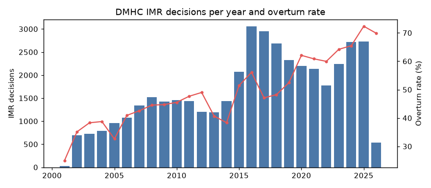
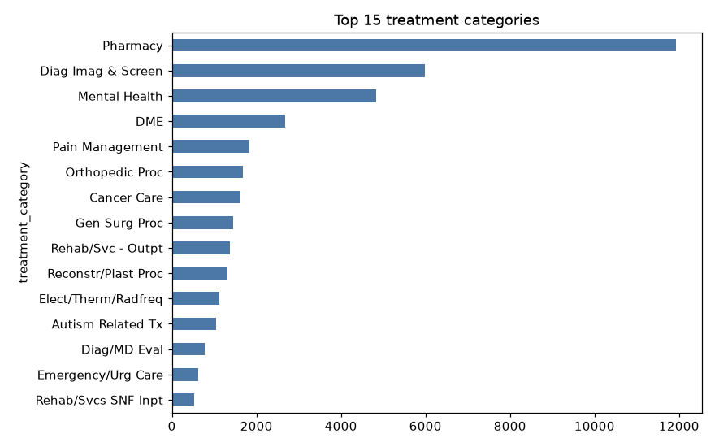
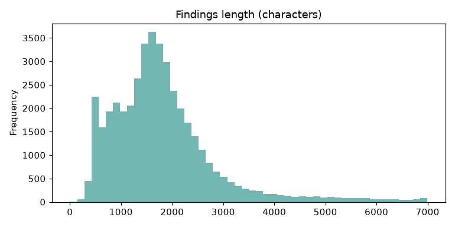

# IMR dataset profile (D1)

Source: California Department of Managed Health Care (DMHC), Independent Medical Review (IMR) Determinations, via the CHHS Open Data Portal (CC BY).

- Rows after cleaning: **42,710**
- Exact duplicate rows dropped: 39
- Years: 2001-2026
- Overall overturn rate: 52.5%
- Raw file SHA-256: `f68951823f6ffc09566cc190d97b2808e0269a069843efe809a3f5f90d4c893b`

## PII scan of Findings (regex, defense in depth)
- Rows with at least one hit: 481
- Hits by entity: {'MRN': 180, 'PERSON': 237, 'MEMBER_ID': 105, 'ADDRESS': 7, 'CLAIM_NUMBER': 3}
- All hits are masked as `[ENTITY]` before indexing. Most hits are expected false positives (e.g. reference-style numbers); see the masked text in `imr_case.findings`.

## Rows by year

| Value | Count | Share |
|---|---:|---:|
| 2016 | 3,053 | 7.1% |
| 2017 | 2,953 | 6.9% |
| 2025 | 2,730 | 6.4% |
| 2024 | 2,715 | 6.4% |
| 2018 | 2,683 | 6.3% |
| 2019 | 2,331 | 5.5% |
| 2023 | 2,246 | 5.3% |
| 2020 | 2,197 | 5.1% |
| 2021 | 2,133 | 5.0% |
| 2015 | 2,076 | 4.9% |
| 2022 | 1,776 | 4.2% |
| 2008 | 1,520 | 3.6% |
| 2010 | 1,452 | 3.4% |
| 2011 | 1,435 | 3.4% |
| 2014 | 1,432 | 3.4% |
| 2009 | 1,429 | 3.3% |
| 2007 | 1,342 | 3.1% |
| 2012 | 1,200 | 2.8% |
| 2013 | 1,195 | 2.8% |
| 2006 | 1,080 | 2.5% |
| 2005 | 959 | 2.2% |
| 2004 | 787 | 1.8% |
| 2003 | 731 | 1.7% |
| 2002 | 689 | 1.6% |
| 2026 | 538 | 1.3% |
| 2001 | 28 | 0.1% |

## Type

| Value | Count | Share |
|---|---:|---:|
| Medical Necessity | 31,480 | 73.7% |
| Experimental/Investigational | 10,462 | 24.5% |
| Urgent Care | 768 | 1.8% |

## IMRType

| Value | Count | Share |
|---|---:|---:|
| Standard | 30,183 | 70.7% |
| Expedited | 12,527 | 29.3% |

## Determination

| Value | Count | Share |
|---|---:|---:|
| Overturned Decision of Health Plan | 22,431 | 52.5% |
| Upheld Decision of Health Plan | 20,279 | 47.5% |

## Top 20 treatment categories

| Value | Count | Share |
|---|---:|---:|
| Pharmacy | 11,936 | 27.9% |
| Diag Imag & Screen | 5,988 | 14.0% |
| Mental Health | 4,830 | 11.3% |
| DME | 2,679 | 6.3% |
| Pain Management | 1,827 | 4.3% |
| Orthopedic Proc | 1,676 | 3.9% |
| Cancer Care | 1,622 | 3.8% |
| Gen Surg Proc | 1,450 | 3.4% |
| Rehab/Svc - Outpt | 1,380 | 3.2% |
| Reconstr/Plast Proc | 1,309 | 3.1% |
| Elect/Therm/Radfreq | 1,115 | 2.6% |
| Autism Related Tx | 1,039 | 2.4% |
| Diag/MD Eval | 776 | 1.8% |
| Emergency/Urg Care | 620 | 1.5% |
| Rehab/Svcs SNF Inpt | 519 | 1.2% |
| Cardio-Vasc Proc | 505 | 1.2% |
| Special Proc | 499 | 1.2% |
| Ear-Nose-Thro Proc | 490 | 1.1% |
| Alternative Tx | 413 | 1.0% |
| Acute Med Svc Inpt | 341 | 0.8% |

## Top 20 diagnosis categories

| Value | Count | Share |
|---|---:|---:|
| Orth/Musculoskeletal | 7,333 | 17.2% |
| Mental Disorder | 6,113 | 14.3% |
| Cancer | 3,704 | 8.7% |
| Endocrine/Metabolic | 3,342 | 7.8% |
| CNS/Neuromusc Dis | 3,302 | 7.7% |
| Cardiac/Circ Problem | 2,157 | 5.1% |
| Digestive System/GI | 1,855 | 4.3% |
| Infectious Disease | 1,795 | 4.2% |
| Autism Spectrum | 1,387 | 3.2% |
| Skin Disorders | 1,310 | 3.1% |
| OB-GYN/Pregnancy | 1,080 | 2.5% |
| Pediatrics | 1,062 | 2.5% |
| GU/Kidney Disorder | 992 | 2.3% |
| Immuno Disorders | 960 | 2.2% |
| Morbid Obesity | 945 | 2.2% |
| Respiratory System | 896 | 2.1% |
| Prevention/Good Hlth | 819 | 1.9% |
| Ears/Nose/Throat | 702 | 1.6% |
| Vision | 416 | 1.0% |
| Foot Disorder | 397 | 0.9% |

## AgeRange (fairness slices only; not a model feature)

| Value | Count | Share |
|---|---:|---:|
| 51 to 64 | 15,554 | 36.4% |
| 41 to 50 | 7,792 | 18.2% |
| 31 to 40 | 5,680 | 13.3% |
| 11 to 20 | 4,377 | 10.2% |
| 21 to 30 | 3,847 | 9.0% |
| 0 to 10 | 2,922 | 6.8% |
| 65+ | 1,853 | 4.3% |
| nan | 685 | 1.6% |

## PatientGender (fairness slices only; not a model feature)

| Value | Count | Share |
|---|---:|---:|
| Female | 24,083 | 56.4% |
| Male | 17,846 | 41.8% |
| nan | 685 | 1.6% |
| Other | 96 | 0.2% |

## Overturn rate by Type

| Type | N | Overturned |
|---|---:|---:|
| Experimental/Investigational | 10,462 | 45.4% |
| Medical Necessity | 31,480 | 55.1% |
| Urgent Care | 768 | 42.3% |

## Null rates

| Column | Null rate |
|---|---:|
| reference_id | 0.00% |
| year | 0.00% |
| diagnosis_category | 0.00% |
| diagnosis_subcategory | 0.00% |
| treatment_category | 0.00% |
| treatment_subcategory | 0.00% |
| type | 0.00% |
| imr_type | 0.00% |
| age_range | 1.60% |
| patient_gender | 1.60% |
| determination_text | 0.00% |
| overturned | 0.00% |
| days_to_review | 1.62% |
| days_to_adopt | 0.00% |
| findings_original | 0.00% |
| findings | 0.00% |

## Findings text length (characters)

| min | p25 | median | p75 | p95 | max |
|---:|---:|---:|---:|---:|---:|
| 1 | 1,147 | 1,654 | 2,188 | 3,818 | 6,996 |

## Charts

